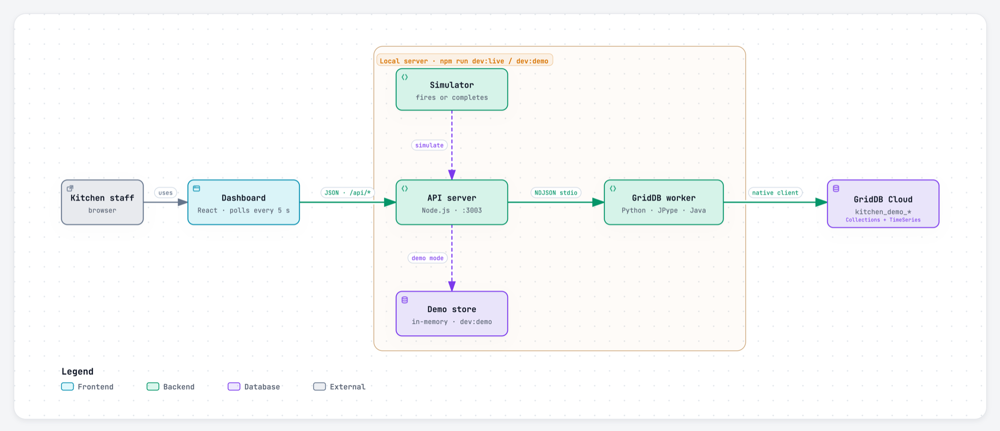
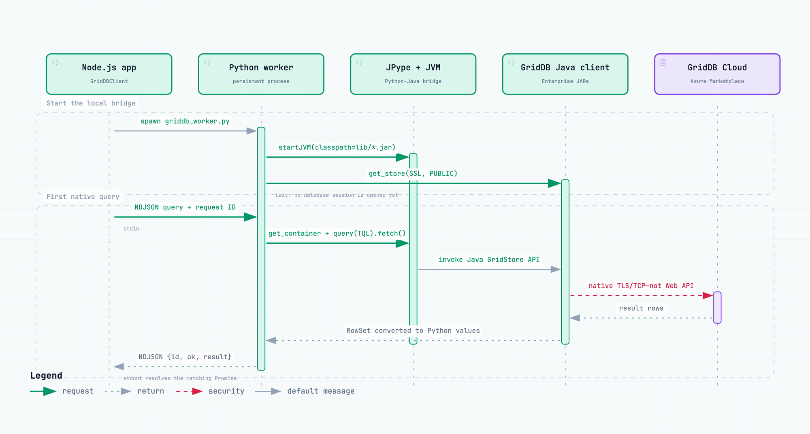
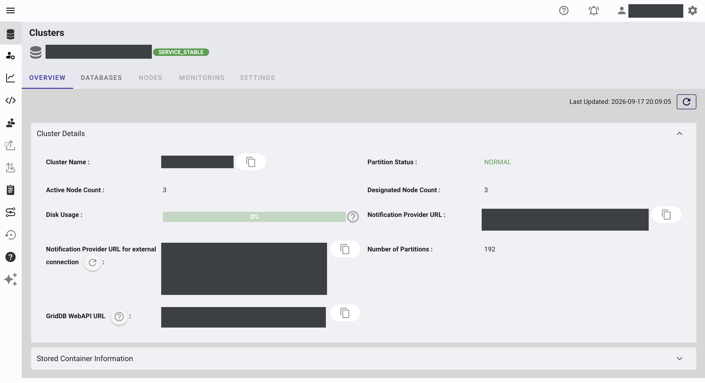
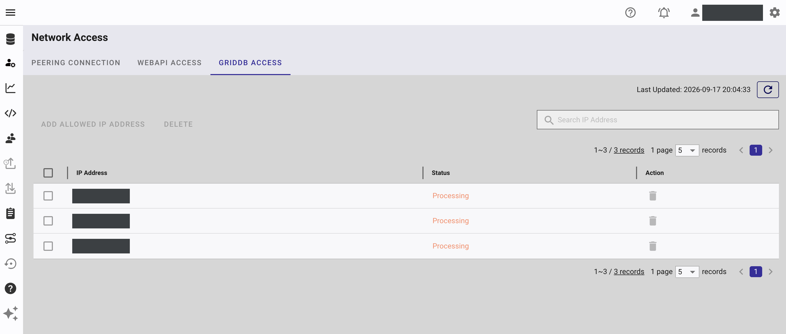
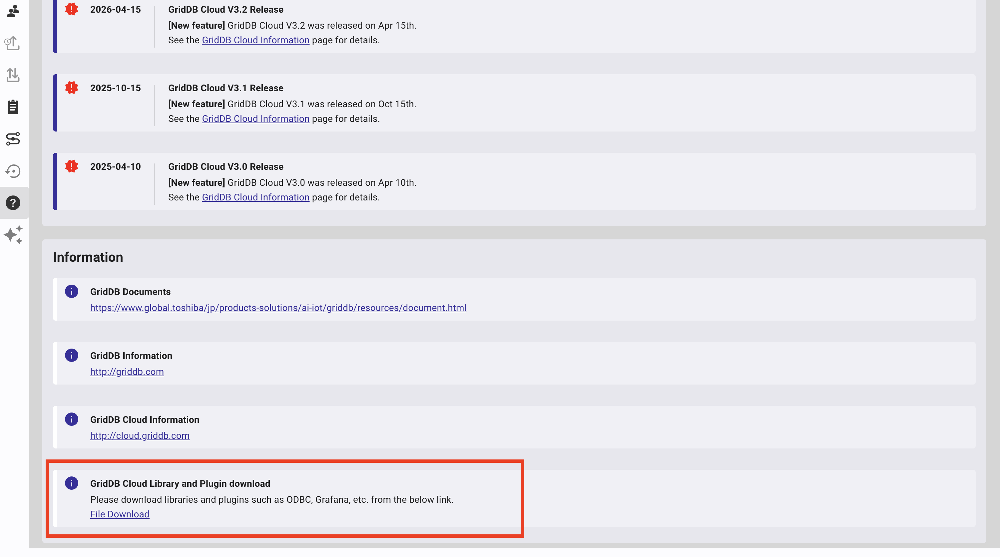
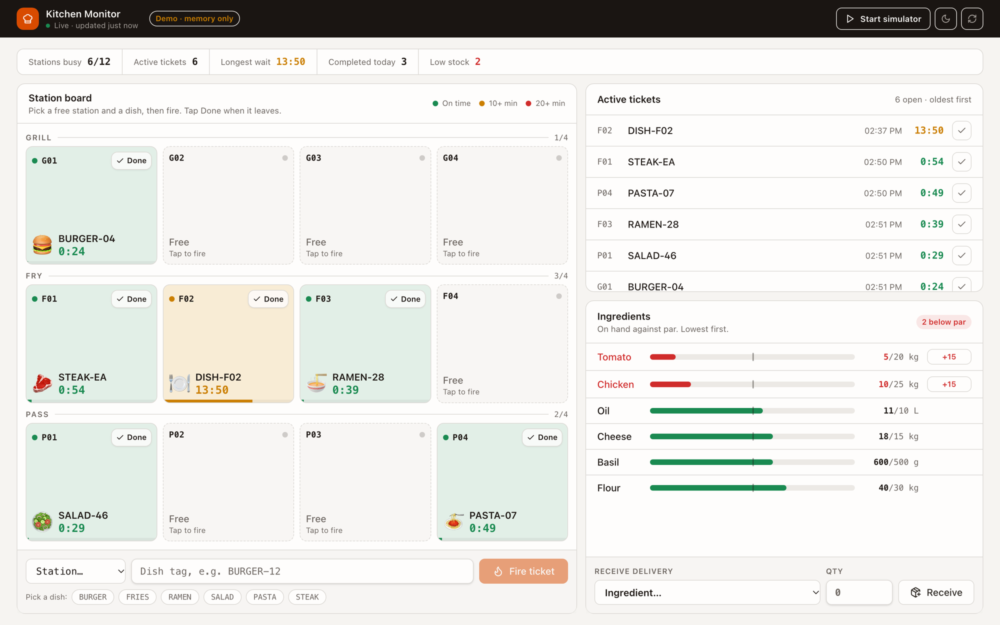
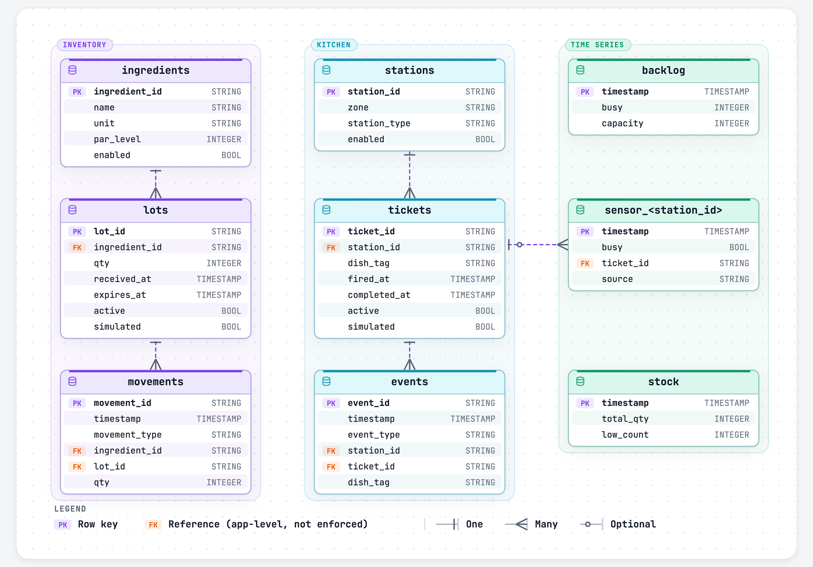
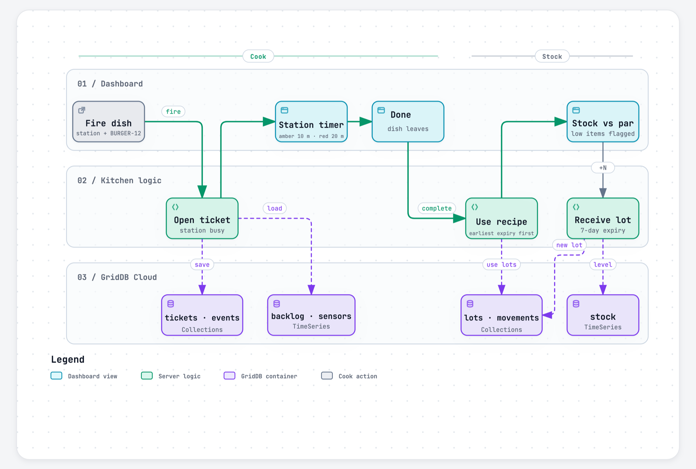

# Building a Restaurant Kitchen Monitor with GridDB Native and Node.js


This tutorial builds a small kitchen monitor: a live dashboard that shows which cooking stations are busy and which ingredients are running low. It uses a React dashboard and a Node.js server, and stores orders, stock, and their history in GridDB Cloud through GridDB's native client.

## Table of Contents

- [Background](#background)
- [What You'll Build](#what-youll-build)
- [Why Use GridDB Native?](#why-use-griddb-native)
- [System Architecture](#system-architecture)
- [Requirements](#requirements)
- [How to Run](#how-to-run)
- [Data Model](#data-model)
- [Bridge Internals and API Surface](#bridge-internals-and-api-surface)
- [Order and Inventory Lifecycles](#order-and-inventory-lifecycles)
- [Load Simulation](#load-simulation)
- [Query Patterns and Examples](#query-patterns-and-examples)
- [Production Integration](#production-integration)
- [Future Work](#future-work)
- [Conclusion](#conclusion)
- [Related Documentation](#related-documentation)

## Background

Picture a busy dinner service. Orders come in, and the head chef sends each dish to a free station: a burger to the grill, fries to the fryer. A ticket board tracks all of this, but it only tells you what was ordered. It cannot tell you whether the kitchen still has the tomatoes to make the next burger.

This app answers both questions on one screen. When a cook marks a dish as done, the app takes that dish's ingredients out of stock. When a delivery arrives, the stock goes back up. If an ingredient falls below the amount the kitchen likes to keep on hand, it is flagged, just as a busy station is. One look at the dashboard tells you which stations are free and what is running low.

## What You'll Build

- A live board of 12 kitchen stations, with a timer on each dish that turns amber at 10 minutes and red at 20.
- An ingredient list that shows stock against its target level and flags anything running low.
- Completing a dish automatically takes its ingredients out of stock.
- A simulator that keeps the kitchen busy, so you can watch it work.
- Two ways to run it: a demo with no database, or live on GridDB Cloud.

## Why Use GridDB Native?

GridDB Cloud also offers a Web API over HTTPS, but some environments don't allow database operations through an HTTP API. Since GridDB Cloud v3.2, native Java and Python clients can connect over the public internet with `connectionRoute=PUBLIC`, so you no longer need a VPN or VNet peering to use them from your own machine.

The native client also fits this app well:

- **Direct row access.** `get(key)` fetches a ticket or lot by its ID, and `put(row)` saves it, with no SQL or JSON mapping in between.
- **TimeSeries containers.** Backlog and stock history go into containers keyed by timestamp, and TQL time-window queries such as `TIMESTAMPADD(HOUR, NOW(), -24)` read them back.
- **One long-lived connection.** A single worker opens the store once and reuses it for every request.

The current GridDB Python client is built on the GridDB Java client through JPype, so this app uses it from a small Python worker. Node.js serves the dashboard and the HTTP API and hands every database call to that worker.

## System Architecture

Here is how the pieces work together during a shift:

1. **A cook fires a dish.** Kitchen staff open the dashboard in a browser, pick a free station, and send it a dish such as `BURGER-12`.
2. **The server saves it.** The dashboard sends the action to the Node.js API server, which checks it and hands it to the Python worker. The worker writes the ticket to GridDB Cloud, and the station turns busy.
3. **The board stays live.** Every 5 seconds the dashboard asks the server for the latest board and stock, so each station's timer and status stay current.
4. **The dish is done.** When the dish leaves the pass, the cook taps **Done**. The worker closes the ticket and takes the dish's ingredients out of stock.
5. **A delivery arrives.** Staff record it from the inventory panel, and the worker adds it to stock.

Two extras help when you are trying it out: the simulator fires and completes dishes every 5 seconds so the board keeps moving, and demo mode swaps GridDB Cloud for an in-memory store so you can run the app without a database.



*Figure 1. Kitchen Monitor architecture: React dashboard, Node.js API, Python worker, and GridDB Cloud.*

Under the hood, the dashboard talks to Node.js over plain HTTP and JSON. Node.js never talks to GridDB directly: it writes each operation as one line of JSON (NDJSON) to the Python worker's stdin, tagged with a request ID, and matches the reply that comes back on stdout. The worker uses the GridDB Python client, which calls the GridDB Java client through JPype, so every read and write travels over GridDB's native connection rather than the Web API. The only HTTPS step is discovery: the client looks up the cluster through the Notification Provider URL.

The worker starts once, together with the server, and stays running. It keeps the JVM and the GridDB store open between requests instead of starting them for every operation, and handles one operation at a time.



*Figure 2. One native request, step by step: Node.js starts a persistent Python worker once, then sends each query as an NDJSON line. The worker calls GridDB through JPype and the Java client over a native TLS/TCP connection, not the Web API, and replies with `{id, ok, result}`.*

See the official [GridDB Python client](https://github.com/griddb/python_client) and [Cloud public native connection article](https://www.griddb.net/en/blog/connecting-to-griddb-cloud-v3-2-from-your-local-dev-environment-no-vpn-no-vnet-peering/) for the client architecture and route configuration.

## Requirements

### Node.js

Install [Node.js](https://nodejs.org/en/download) 22 or newer. The API server uses built-in Node modules for the HTTP server and process bridge. The dashboard is a React application built with Vite, Tailwind CSS, and shadcn-style components; the workspace commands build it before starting the API, which serves the static output from `dashboard/dist`.

### Python

[Python](https://www.python.org/downloads/) 3.12 is recommended. The macOS setup script installs the GridDB Python package, JPype, and PyArrow into the project virtual environment at `apps/native-bridge/.venv/`.

### Java and Maven

The GridDB Python client invokes the Java API through JPype. The included macOS setup script uses Homebrew to install OpenJDK 21 and Maven, then builds the Arrow adapter. On other systems, install a Java 21 JDK such as [Eclipse Temurin](https://adoptium.net/temurin/releases/?version=21) and [Apache Maven](https://maven.apache.org/download.cgi) yourself.

### GridDB Cloud

Use a GridDB Cloud service with a supported public native route. From the portal:

1. Generate the Notification Provider URL.
2. Add your application's public outbound IP to the GridDB access list.
3. Download the compatible Cloud Java library bundle and extract `gridstore-advanced.jar` into `apps/native-bridge/lib/`.

The setup script supplies the public libraries; it does not download the licensed Cloud JAR. Keep the JAR and real credentials outside a public repository.



*Figure 3. The cluster overview shows the Notification Provider URL for external connections.*



*Figure 4. Allow your application's public outbound IP under GridDB Access.*



*Figure 5. Where to download the GridDB Cloud Java library.*

## How to Run

This part is optional: follow it if you want to try the app yourself. Steps 1 to 6 run it against your own GridDB Cloud. If you only want to look around, clone the repository and jump to the demo at the end of step 6.

### 1. Clone the repository

```bash
git clone https://github.com/junwatu/restaurant-kitchen-operations-monitor.git
cd restaurant-kitchen-operations-monitor/apps
npm install
```

The app lives in `apps/`, and every command below runs from there.

### 2. Install the native dependencies

On macOS:

```bash
npm run setup:mac
```

The setup script needs [Homebrew](https://brew.sh). It installs Java and Maven, creates the Python virtual environment, builds the GridDB Python client, and prepares the public runtime JARs. On Linux and Windows, install these manually by following the official client instructions.

### 3. Install the GridDB Cloud JAR

Extract `gridstore-advanced.jar` from the Cloud Java library bundle you downloaded, and copy it to:

```text
native-bridge/lib/gridstore-advanced.jar
```

Or pass the Cloud Java library RPM from the bundle to the installer, which extracts the JAR for you:

```bash
npm run install:cloud-jar -- "/path/to/griddb-ee-java-lib-5.9.0-linux.x86_64.rpm"
```

The runtime directory should now contain these four files:

```text
gridstore.jar
gridstore-arrow.jar
arrow-memory-netty.jar
gridstore-advanced.jar
```

This project loads the Java client, so pick the Cloud Java library bundle, not the Web API or C client package.

### 4. Configure environment variables

Copy the example environment file:

```bash
cp native-bridge/.env.example native-bridge/.env
```

Fill in your own values:

```dotenv
GRIDDB_NOTIFICATION_PROVIDER='https://your-provider-url'
GRIDDB_CLUSTER_NAME='your-cluster'
GRIDDB_DATABASE='your-database'
GRIDDB_USERNAME='your-user'
GRIDDB_PASSWORD='your-password'
GRIDDB_CONNECTION_ROUTE='PUBLIC'
GRIDDB_SSL_MODE='PREFERRED'
GRIDDB_REQUEST_TIMEOUT_MS='30000'
KITCHEN_CONTAINER_PREFIX='kitchen_demo'
KITCHEN_API_HOST='127.0.0.1'
KITCHEN_API_PORT='3003'
```

The workspace commands load `native-bridge/.env` automatically, and shell environment variables take precedence. Keep the provider URL quoted, do not commit `.env`, and use a dedicated database or container prefix. The prefix must start with a letter and contain at most 41 letters, digits, or underscores.

Now check the local setup:

```bash
npm run doctor
```

`doctor` checks the configuration and local dependencies only. A passing check does not mean GridDB Cloud is reachable yet.

### 5. Initialize the GridDB containers

```bash
npm run init
```

This creates the containers: six Collections, two TimeSeries, and one `sensor_` TimeSeries per station (12 in all). Running it again keeps compatible containers, and an incompatible existing schema stops initialization without deleting any data.

Example output, abbreviated:

```text
[
  {
    "name": "kitchen_demo_stations",
    "status": "created"
  },
  {
    "name": "kitchen_demo_tickets",
    "status": "created"
  },
  {
    "name": "kitchen_demo_events",
    "status": "created"
  },
  ...
  {
    "name": "kitchen_demo_sensor_G01",
    "status": "created"
  },
  ...
]
```

If `init` times out, your outbound IP is usually missing from the GridDB Cloud access list. Add it in the portal and retry.

### 6. Seed the kitchen and start the app

Seed the stations and ingredients. This adds anything missing and keeps existing tickets and stock.

```bash
npm run seed
```

Check the GridDB connection:

```bash
npm run dev:griddb
```

Start the live server. It checks the connection and the seeded stations before it starts listening:

```bash
npm run dev:live
```

Then open this URL in your browser:

```text
http://127.0.0.1:3003
```

The header shows `GridDB Cloud`. A live database starts with no stock: `seed` creates the ingredients but no lots. Before you complete dishes, use **+N** in the inventory panel to receive a delivery for each ingredient; otherwise each completed dish shows a "not enough" warning.

To try it, tap a free station, pick a dish (the tag gets a random order number, such as `PASTA-26`), and press **Fire**. The tile shows a running timer that turns amber at 10 minutes and red at 20; press **Done** when the dish leaves. On the inventory side, **+N** next to a low ingredient prefills a delivery that brings it back to par. Start the simulator from the header when you want extra activity; it is stopped by default.

You can also run the demo version, which needs only step 1:

```bash
npm run dev:demo
```

The header says `Demo · memory only`. The demo starts with three busy stations and sample stock (tomato and chicken already below par), keeps everything in memory, and resets when the server stops. Stop the live server first, because both use port 3003.



*Figure 6. The dashboard in demo mode: the station board on the left, active tickets and ingredient levels on the right. One dish has passed 10 minutes and turned amber, and tomato and chicken are below par.*

## Data Model

All container names begin with `KITCHEN_CONTAINER_PREFIX` (default `kitchen_demo`).



*Figure 7. Kitchen Monitor data model: nine container types grouped as inventory, kitchen, and time series. References between containers are kept by the app; GridDB does not enforce them.*

The containers fall into three groups:

**Inventory**

- `ingredients`: the six ingredients the kitchen tracks, each with its unit and par level. The dashboard compares on-hand stock against par to flag low items.
- `lots`: one row per delivery, with the remaining quantity and expiry date. On-hand stock is the sum of active lots, and recipes draw from the earliest-expiring lot first.
- `movements`: the audit trail of every receive, consume, and waste, one row per lot touched. Its predictable IDs also make retries safe.

**Kitchen**

- `stations`: the 12 stations across the Grill, Fry, and Pass zones. A disabled station cannot take tickets.
- `tickets`: the source of truth for orders, one active ticket per station. It drives the station board and the completed-today count.
- `events`: a log of every fired and completed ticket, read by `/api/events` for recent activity.

**Time series**

- `backlog`: busy stations against capacity, sampled on every fire and complete. `/api/history` reads it for load over time.
- `sensor_<stationId>`: one container per station, recording whether it was busy and with which ticket at each sample. The app writes these for per-station history but does not read them yet.
- `stock`: total on-hand quantity and the number of low ingredients after every inventory change. `/api/stock-history` reads it for stock over time.

[Full column reference](https://github.com/junwatu/restaurant-kitchen-operations-monitor/blob/main/docs/data-model.md): every column, its type, and what it holds.

## Bridge Internals and API Surface

### Node.js API routes

The browser talks to `src/server.js`, which uses Node's built-in `node:http` module and serves the dashboard files too.

| Method | Route | Function |
| --- | --- | --- |
| GET | `/api/health` | Real native database check; demo reports no database |
| GET | `/api/kitchen` | Stations, active tickets, summary, simulator status |
| GET | `/api/events` | Newest 100 ticket events |
| GET | `/api/history?hours=24` | Up to 1,000 backlog samples, 1–168h window |
| POST | `/api/tickets/fire` | Fire a ticket: `{ticketId, stationId, dishTag}` |
| POST | `/api/tickets/complete` | Complete a ticket and use its recipe's ingredients: `{ticketId}` |
| GET | `/api/inventory` | Ingredients with on-hand qty and low flags |
| GET | `/api/movements` | Newest 100 inventory movements |
| GET | `/api/stock-history?hours=24` | Stock-level history, 1–168h window |
| POST | `/api/inventory/receive` | Receive a lot: `{lotId, ingredientId, qty, expiresInDays?}` |
| POST | `/api/inventory/consume` | Consume or waste: `{consumeId, lotId, qty, kind?}` |
| POST | `/api/simulator/start` | Start the simulator timer; send `{}` |
| POST | `/api/simulator/stop` | Stop the simulator timer; send `{}` |

POST routes require `Content-Type: application/json`. Firing a ticket, receiving a lot, or recording a consume/waste returns 201 the first time and 200 for a matching retry. Completing a ticket returns 200. Invalid input returns 400, unknown tickets/lots return 404, conflicts return 409 (busy station, reused ID with a different payload, empty lot, not enough stock), and native failures return 503.

### How the server handles a request

A request passes through three layers in `src/`: `server.js` routes it, `kitchen-service.js` checks the input, and `griddb-client.js` sends it to the Python worker. The snippets below are trimmed from those files.

**1. Route the request.** The server is plain `node:http`. Each route calls one service method. A creating write returns 201 the first time and 200 for a retry, and the error name sent back by the worker becomes the HTTP status:

```js
const statuses = { ValueError: 400, ConflictError: 409, LookupError: 404 };

const server = createServer(async (req, res) => {
  try {
    const url = new URL(req.url, origin);
    let result;
    let status = 200;
    if (req.method === 'GET' && url.pathname === '/api/kitchen') result = await service.snapshot();
    else if (req.method === 'POST' && url.pathname === '/api/tickets/fire') {
      result = await service.fire(await body(req));
      status = result.replayed ? 200 : 201;
    }
    // ...the other routes
    else { json(res, 404, { error: 'Endpoint not found' }); return; }
    json(res, status, result);
  } catch (error) {
    json(res, error.status || statuses[error.name] || 503, { error: error.message });
  }
});
```

**2. Check the input.** `KitchenService` rejects bad input before anything reaches GridDB, then passes a clean payload to the worker:

```js
export function firePayload(body) {
  const dishTag = typeof body.dishTag === 'string' ? body.dishTag.trim().toUpperCase() : '';
  if (!UUID_RE.test(body.ticketId)) invalid('Provide a UUID ticketId so retries are idempotent');
  if (!STATION_RE.test(body.stationId)) invalid('Invalid kitchen station');
  if (!/^[A-Z0-9 -]{1,16}$/.test(dishTag)) invalid('Dish tag must contain 1–16 letters, digits, spaces or hyphens');
  return { ticketId: body.ticketId.toLowerCase(), stationId: body.stationId, dishTag };
}

async fire(body) { return this.store.request('fire', firePayload(body)); }
```

**3. Send it to the worker.** `GridDBClient.request` writes one JSON line to the worker's stdin with a numbered `id` and keeps the promise in a pending map. When the worker prints its reply line, the client finds the promise by `id` and settles it. If no reply arrives in time (30 seconds by default), the client stops the worker, because the write may or may not have happened:

```js
request(operation, payload = {}) {
  const id = this.#nextId++;
  return new Promise((resolve, reject) => {
    const timer = setTimeout(() => {
      this.#failAll(new Error(`GridDB operation ${operation} timed out; the write outcome may be unknown.`));
      this.#child.kill('SIGKILL');
    }, this.#timeoutMs);
    this.#pending.set(id, { resolve, reject, timer });
    this.#child.stdin.write(`${JSON.stringify({ ...payload, id, operation })}\n`);
  });
}

#handleLine(line) {
  const message = JSON.parse(line);
  const pending = this.#pending.get(message.id);
  if (!pending) return;
  clearTimeout(pending.timer);
  this.#pending.delete(message.id);
  if (message.ok) return pending.resolve(message.result);
  const error = new Error(message.error.message);
  error.name = message.error.type;   // ValueError, ConflictError, LookupError...
  pending.reject(error);
}
```

Here is what actually crosses the pipe when a cook fires `BURGER-12` at station G01. Node.js writes one line:

```json
{"ticketId":"5b5207cb-92ab-491e-b410-132535258ba1","stationId":"G01","dishTag":"BURGER-12","id":7,"operation":"fire"}
```

The worker saves the ticket and prints one line back with the same `id`:

```json
{"id":7,"ok":true,"result":{"ticket":{"id":"5b5207cb-92ab-491e-b410-132535258ba1","stationId":"G01","dishTag":"BURGER-12","firedAt":"2026-11-13T18:42:05.123Z","completedAt":null,"active":true,"simulated":false},"replayed":false,"warnings":[]}}
```

If the station is already busy, the reply carries the error instead, and the server turns `ConflictError` into a 409:

```json
{"id":7,"ok":false,"error":{"type":"ConflictError","message":"Station is already busy"}}
```

In demo mode the server gets a `DemoStore` instead of a `GridDBClient`. It has the same `request(operation, payload)` method, so the routes and the service don't change.

### Connecting to GridDB Cloud

When the worker starts, it loads the GridDB Java client into a JVM and opens the store. This is trimmed from `start_gridstore()` in `python/griddb_worker.py`:

```python
import os
from pathlib import Path
import jpype

lib = Path(__file__).resolve().parents[1] / "lib"
if not jpype.isJVMStarted():
    jpype.startJVM(classpath=[str(path) for path in sorted(lib.glob("*.jar"))])

import griddb_python as griddb  # import after the JVM is running

store = griddb.StoreFactory.get_instance().get_store(
    notification_provider=os.environ["GRIDDB_NOTIFICATION_PROVIDER"],
    cluster_name=os.environ["GRIDDB_CLUSTER_NAME"],
    database=os.environ["GRIDDB_DATABASE"],
    username=os.environ["GRIDDB_USERNAME"],
    password=os.environ["GRIDDB_PASSWORD"],
    ssl_mode=os.environ.get("GRIDDB_SSL_MODE", "PREFERRED"),
    connection_route="PUBLIC",
)
```

A few details matter here:

- **The four JARs.** `lib/` holds `gridstore.jar`, `gridstore-arrow.jar`, `arrow-memory-netty.jar`, and `gridstore-advanced.jar`. The last one comes from the GridDB Cloud download (step 3 of How to Run) and is needed for the Cloud's SSL connection. The worker refuses to start if any of them is missing.
- **`PUBLIC` must be uppercase.** It tells the client to use the public route. The app reads it from `GRIDDB_CONNECTION_ROUTE`; for private access over Azure VNet peering you leave it empty.
- **The connection is lazy.** `get_store` doesn't contact the cluster. The first container call does, which is why `npm run dev:griddb` makes one real request to prove the connection works.

The worker keeps this `store` for its whole life and closes it on shutdown.

### CRUD with the native client

All database work happens in the Python worker, through the GridDB Python client running on the Java client. The snippets below are trimmed from `python/init_schema.py` and `python/kitchen.py`.

**Create a container.** `npm run init` defines each container once. A row key makes the first column the primary key, and a TimeSeries uses its timestamp as the key:

```python
import griddb_python as griddb

LOTS = (("lot_id", "STRING"), ("ingredient_id", "STRING"), ("qty", "INTEGER"),
        ("received_at", "TIMESTAMP"), ("expires_at", "TIMESTAMP"),
        ("active", "BOOL"), ("simulated", "BOOL"))

info = griddb.ContainerInfo(
    "kitchen_demo_lots",
    [[name, getattr(griddb.Type, kind)] for name, kind in LOTS],
    type=griddb.ContainerType.COLLECTION,
    row_key=True,
)
store.put_container(info, modifiable=False)
```

**Create a row.** `put` writes a row as a list, in column order. Receiving a delivery saves the lot, then its `receive` movement:

```python
con = store.get_container("kitchen_demo_lots")
con.put([lot_id, "TOMATO", 25, now, now + timedelta(days=7), True, False])
con.close()

movements = store.get_container("kitchen_demo_movements")
movements.put([f"{lot_id}_receive", now, "receive", "TOMATO", lot_id, 25])
movements.close()
```

**Read rows.** `get` fetches one row by key. `query` runs TQL and returns a row set:

```python
lot = con.get(lot_id)  # None if the key doesn't exist

rs = con.query("SELECT * WHERE active LIMIT 1001").fetch()
rows = []
while rs.has_next():
    rows.append(rs.next())
rs.close()
```

**Update a row.** `put` on an existing key replaces the row, so an update is read, change, put. Using 5 kg from a lot looks like this:

```python
lot = con.get(lot_id)
lot[2] -= 5             # qty
if lot[2] == 0:
    lot[5] = False      # active
con.put(lot)
```

**Delete.** The app never deletes rows. A finished ticket or an empty lot is marked `active = False` instead, so it stays in the audit trail and out of the live board. If you do need a hard delete, the client has `con.remove(key)`.

In the app these calls sit behind three small helpers in `python/kitchen.py`: `put`, `get`, and `read` (a TQL query). Each one opens the container, runs the call, and closes it.

### What happens if a request is sent twice?

The requests here are the `POST` calls that change data: firing a dish (`/api/tickets/fire`), receiving a delivery (`/api/inventory/receive`), and recording use or waste (`/api/inventory/consume`). For example, a cook taps **Fire**, the server saves the ticket in GridDB, but the reply never reaches the browser because of a network blip or timeout. The dashboard can't tell whether it worked, so it sends the same request again.

To keep that from creating a second ticket or counting a delivery twice, the caller picks the ID before sending: `ticketId` for fire, `lotId` for receive, and `consumeId` for use or waste. A retry reuses the same ID, and the dashboard does this for fire and receive. This makes the requests idempotent: sending one twice has the same effect as sending it once.

- **New ID:** the row is saved (201).
- **Same ID and same details:** nothing new is saved, and the existing row comes back with `replayed: true` (200).
- **Same ID, different details:** the request is rejected (409).

Completing a dish works the same way: if the ticket is already done, the server returns it without using the ingredients again.

## Order and Inventory Lifecycles



*Figure 8. How the Kitchen Monitor works: a dish from fire to restock, and what each step writes to GridDB.*

Figure 8 follows one dish, `BURGER-12`, from the moment a cook fires it to the moment its ingredients are restocked.

1. **Fire the dish.** The cook picks a free grill station and taps **Fire**. A new row goes into `tickets` with `active = true`, and the station turns busy on the board. (`completed_at` gets a placeholder copy of `fired_at`, because the column can't be empty. The API shows it as `null` until the dish is done.)
2. **Watch the timer.** The board counts up from `fired_at`. The station turns amber after 10 minutes and red after 20.
3. **Mark it done.** When the burger leaves the station, the cook taps **Done**. The ticket is updated to `active = false` with the real `completed_at`, and the station is free again. The row is kept, so it still counts toward "completed today".
4. **Use the ingredients.** The server looks up the burger's recipe (1 kg cheese, 1 kg tomato) and takes each amount from the lots that expire soonest. Every lot it draws from gets a `consume` row in `movements`, a lot that reaches zero is marked inactive, and a new `stock` sample records the totals.
5. **Spot low stock.** The board adds up each ingredient's active lots and compares the total with its par level. Anything below par is flagged as low.
6. **Restock.** The cook taps **+N** next to a low ingredient, which fills in the amount that brings it back to par, and submits the delivery. That creates a new lot (expiring in 7 days by default), a `receive` movement, and another `stock` sample.

A few things worth knowing:

- **The ticket comes first.** The ticket is saved before any ingredients are used. If stock runs short, the dish still completes, because the food has already left the station; the API just returns a warning such as `Not enough Tomato for BURGER-12: short by 1.`
- **Only known dishes use stock.** Ingredients are only used for the six dishes with a recipe. Any other tag uses nothing.
- **Expiry is recorded, not enforced.** Nothing throws out expired lots in this draft. An expired lot still counts toward stock, and since the oldest expiry is used first, it's the first to go.

The six recipes live in `Kitchen.RECIPES` in `python/kitchen.py`, with a copy in the demo store. A dish is matched by the part of its tag before the dash, so `BURGER-12` uses the BURGER recipe. Amounts are whole units, because a lot's `qty` is an `INTEGER` column, so the portions are oversized on purpose (1 kg of cheese per burger) to make the stock bars move visibly:

| Dish | Uses |
| --- | --- |
| BURGER | 1 kg cheese, 1 kg tomato |
| FRIES | 1 L oil |
| RAMEN | 1 kg chicken, 1 kg flour |
| SALAD | 1 kg tomato, 20 g basil |
| PASTA | 1 kg flour, 1 kg tomato, 1 kg cheese, 10 g basil |
| STEAK | 1 L oil, 10 g basil |

## Load Simulation

The simulator keeps the dashboard busy without a real kitchen behind it, so you can watch the station board and the stock levels change, and build up backlog and stock history for the API to return. It is stopped by default. Start and stop it with the **Start simulator** button in the dashboard header.

Every 5 seconds it does one of two things:

- **Completes a dish:** it picks a random ticket that the simulator fired itself and marks it done. That happens 45% of the time, or every time if no station is free. Completing the dish uses its recipe's ingredients, just like a cook tapping **Done**.
- **Fires a dish:** otherwise, it fires a random dish at a random free station with a tag like `BURGER-A3`.

It never completes tickets that a cook fired. If every station is busy with a cook's tickets, nothing changes that tick. If a request fails, it stops and the dashboard shows the error.

Because every simulated dish uses ingredients, stock keeps falling while the simulator runs. It never restocks, so use **+N** to receive deliveries when items go low.

> **Note:** In live mode the simulator writes real tickets, events, and stock changes to GridDB Cloud under your container prefix, and it uses up the stock you received. Use a dedicated prefix or database if you don't want sample data mixed with real data.

## Query Patterns and Examples

A stock-history request shows the full path. An API client calls `GET /api/stock-history?hours=24`; `KitchenService.stockHistory` validates the window and sends `{operation: "stock_history", hours}` to the worker; `kitchen.stock_history` runs the TQL query against the `stock` TimeSeries and returns `{points, limit, possiblyTruncated}`.

```bash
curl 'http://127.0.0.1:3003/api/inventory'
curl 'http://127.0.0.1:3003/api/stock-history?hours=24'
curl -X POST http://127.0.0.1:3003/api/inventory/receive \
  -H 'Content-Type: application/json' \
  -d '{"lotId":"7b5207cb-92ab-491e-b410-132535258ba1","ingredientId":"TOMATO","qty":25}'
curl -X POST http://127.0.0.1:3003/api/inventory/consume \
  -H 'Content-Type: application/json' \
  -d '{"consumeId":"8b5207cb-92ab-491e-b410-132535258ba1","lotId":"7b5207cb-92ab-491e-b410-132535258ba1","qty":5}'
```

### TQL used by the worker

All reads go through `container.query(tql).fetch()` in `python/kitchen.py`. The browser never sends TQL. Each query is fixed in the worker, and only validated integers (like `hours`) or server-computed timestamps are put into it.

| Purpose | Container | TQL |
| --- | --- | --- |
| Active tickets | `tickets` | `SELECT * WHERE active LIMIT 1001` |
| Completed today | `tickets` | `SELECT * WHERE NOT active AND completed_at >= TIMESTAMP('<UTC midnight>') LIMIT 5001` |
| Backlog window | `backlog` | `SELECT * WHERE timestamp > TIMESTAMPADD(HOUR, NOW(), -24) ORDER BY timestamp DESC LIMIT 1000` |
| Stock window | `stock` | `SELECT * WHERE timestamp > TIMESTAMPADD(HOUR, NOW(), -24) ORDER BY timestamp DESC LIMIT 1000` |
| Active lots | `lots` | `SELECT * WHERE active LIMIT 1001` |
| Recent movements | `movements` | `SELECT * ORDER BY timestamp DESC LIMIT 100` |

The `LIMIT 1001` reads are deliberate. Fetching one row past the expected maximum lets the worker detect overflow and fail loudly, instead of silently showing a partial board or under-counting stock. Time windows run against TimeSeries containers keyed by timestamp. Business records with stable IDs live in Collections, so retries and updates can fetch them directly with `get(key)`.

## Production Integration

Station projections and stock samples are derived from app activity, not from sensors or POS data. A real deployment needs its own ingestion: ticket firing from the POS, lot receiving from the supplier flow, expiry sweeps, and reconciliation jobs for missed projections. Keep credentials, raw TQL, and container selection off the browser, and add operator auth, HTTPS, rate limits, and retention before any public deployment. The API only accepts writes from loopback origins, which is fine for a local tool but is not authentication.

Two operational notes. Each fire or complete writes the ticket, an event, a backlog sample, and 12 sensor samples, and a complete also writes the lots and movements its recipe draws from, opening each container per write. Over a public Cloud route that adds noticeable latency, so batch the projections or drop the per-station sensor containers if it matters. And a native timeout kills the worker on purpose, because the write outcome is unknown; the API then fails every request until it is restarted and the data reconciled.

## Future Work

- Real portion sizes: store quantities in grams and millilitres so recipes can use realistic amounts, and manage recipes as data instead of code.
- Expiry sweeps: nightly job that wastes expired lots and records the movement.
- Par-level tuning per weekday and supplier lead times.
- Waste analytics: waste share per ingredient and per station.
- Multi-kitchen prefixes with a shared ingredient catalog.

## Conclusion

In this tutorial, we built a kitchen monitor that answers two questions on one screen: which stations are free, and whether there is still enough stock to cook the next dish. Firing a dish, marking it done, and receiving a delivery each become a few rows in GridDB Cloud, and the dashboard reads them back every 5 seconds.

A few design choices hold it together. Tickets and lots are the source of truth: they are saved first, and everything else (events, movements, backlog and stock history) is written after them, so a failed history write never loses an order. Every write that creates something carries an ID picked by the caller, so a retried request can't create a duplicate ticket or count a delivery twice. And one long-lived Python worker owns the native GridDB connection, so Node.js only ever exchanges small JSON lines with it.

The same pattern carries beyond the demo. Swap the simulator for a POS feed and the receive form for a supplier delivery feed, and the containers, queries, and dashboard stay the same.

## Related Documentation

- GridDB Python client: <https://github.com/griddb/python_client>
- Connecting to GridDB Cloud from a local environment: <https://www.griddb.net/en/blog/connecting-to-griddb-cloud-v3-2-from-your-local-dev-environment-no-vpn-no-vnet-peering/>
- GridDB data model (Collections vs TimeSeries): <https://docs.griddb.net/architecture/data-model.html>
