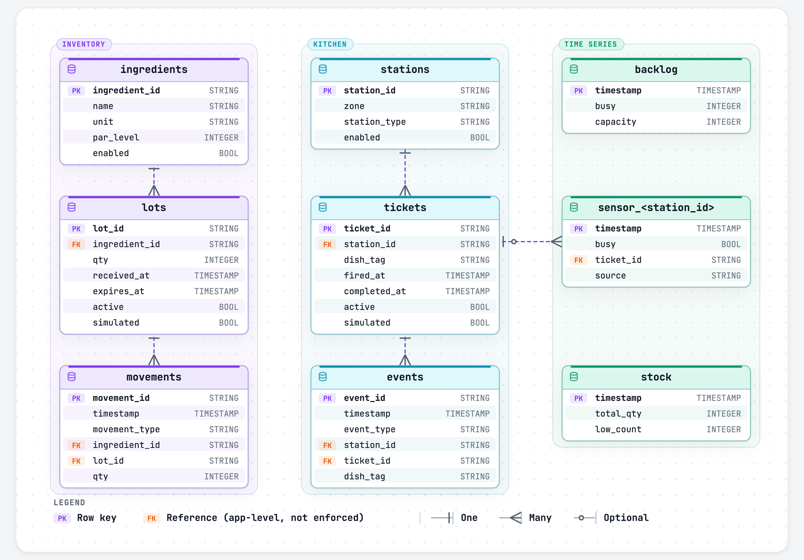

# Data Model

Column reference for the GridDB containers used by the Kitchen Monitor. The schema is defined in [`apps/native-bridge/python/init_schema.py`](../apps/native-bridge/python/init_schema.py); `npm run init` creates these containers and refuses incompatible schemas without deleting data.

All container names begin with `KITCHEN_CONTAINER_PREFIX` (default `kitchen_demo`), for example `kitchen_demo_tickets`.

References between containers (such as `lots.ingredient_id`) are kept by the app; GridDB does not enforce them.

## Containers

| Suffix | Type | Purpose |
| --- | --- | --- |
| `stations` | Collection | Station metadata (zone, type, enabled) |
| `tickets` | Collection | Authoritative tickets |
| `events` | Collection | Fired/completed audit projection |
| `backlog` | TimeSeries | Busy-station history |
| `sensor_<id>` | TimeSeries | Per-station busy projection |
| `ingredients` | Collection | Ingredient metadata, unit, par level |
| `lots` | Collection | Received lots with qty and expiry |
| `movements` | Collection | Receive/consume/waste audit projection |
| `stock` | TimeSeries | Total qty on hand and low-ingredient count |

## `stations` Collection

| Column | Type | Description |
| --- | --- | --- |
| `station_id` | STRING, row key | `G01`–`G04`, `F01`–`F04`, `P01`–`P04` |
| `zone` | STRING | `Grill`, `Fry`, or `Pass` |
| `station_type` | STRING | Lowercase zone name |
| `enabled` | BOOL | Disabled stations cannot take tickets |

## `tickets` Collection

| Column | Type | Description |
| --- | --- | --- |
| `ticket_id` | STRING, row key | Caller-generated UUID |
| `station_id` | STRING | Station reference |
| `dish_tag` | STRING | 1–16 uppercase letters, digits, spaces, or hyphens |
| `fired_at` | TIMESTAMP | Fire time in UTC |
| `completed_at` | TIMESTAMP | Equal to `fired_at` until the ticket is completed |
| `active` | BOOL | True until completed |
| `simulated` | BOOL | Whether the simulator created the ticket |

## `events` Collection

| Column | Type | Description |
| --- | --- | --- |
| `event_id` | STRING, row key | `<ticketId>_fired` or `<ticketId>_completed` |
| `timestamp` | TIMESTAMP | Event time in UTC |
| `event_type` | STRING | `fired` or `completed` |
| `station_id` | STRING | Station reference |
| `ticket_id` | STRING | Ticket reference |
| `dish_tag` | STRING | Copied from the ticket |

## `backlog` TimeSeries

| Column | Type | Description |
| --- | --- | --- |
| `timestamp` | TIMESTAMP, row key | Sample time in UTC |
| `busy` | INTEGER | Active tickets (busy stations) |
| `capacity` | INTEGER | Enabled stations |

## `sensor_<stationId>` TimeSeries

One container per station, written with every backlog sample.

| Column | Type | Description |
| --- | --- | --- |
| `timestamp` | TIMESTAMP, row key | Sample time in UTC |
| `busy` | BOOL | Whether the station has an active ticket |
| `ticket_id` | STRING | Active ticket, or empty when free |
| `source` | STRING | Always `ticket_projection` in this app |

## `ingredients` Collection

| Column | Type | Description |
| --- | --- | --- |
| `ingredient_id` | STRING, row key | e.g. `TOMATO`, `CHEESE` |
| `name` | STRING | Display name |
| `unit` | STRING | `kg`, `g`, or `L` |
| `par_level` | INTEGER | Reorder threshold in the same unit |
| `enabled` | BOOL | Whether the ingredient accepts receives |

Seeded with six ingredients: tomato, cheese, flour, chicken, basil, oil.

## `lots` Collection

| Column | Type | Description |
| --- | --- | --- |
| `lot_id` | STRING, row key | UUID for one delivery |
| `ingredient_id` | STRING | Ingredient reference |
| `qty` | INTEGER | Remaining quantity; decremented by consume/waste |
| `received_at` | TIMESTAMP | Receive time in UTC |
| `expires_at` | TIMESTAMP | Receive time plus `expiresInDays` (default 7) |
| `active` | BOOL | False once the lot hits zero |
| `simulated` | BOOL | Whether the simulator created the lot |

UUID keys let distinct deliveries share a timestamp. A lot at zero stays for audit and retry handling.

## `movements` Collection

| Column | Type | Description |
| --- | --- | --- |
| `movement_id` | STRING, row key | `<lotId>_receive` for receives; `<ticketId>_<ingredientId>_<lotId>` for recipe use; the caller's `consumeId` UUID for manual consume/waste |
| `timestamp` | TIMESTAMP | Movement time in UTC |
| `movement_type` | STRING | `receive`, `consume`, or `waste` |
| `ingredient_id` | STRING | Ingredient reference |
| `lot_id` | STRING | Lot reference |
| `qty` | INTEGER | Moved quantity |

## `stock` TimeSeries

| Column | Type | Description |
| --- | --- | --- |
| `timestamp` | TIMESTAMP, row key | Sample time in UTC |
| `total_qty` | INTEGER | Sum of on-hand qty across active lots |
| `low_count` | INTEGER | Ingredients below par |
